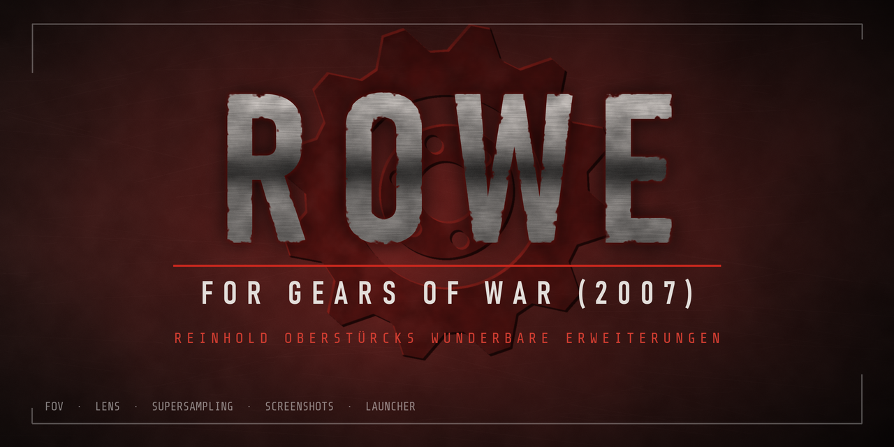

# ROWE for Gears of War (2007)



*ROWE: Reinhold Oberstürcks wunderbare Erweiterungen.*

A mod for **Gears of War for Windows** (PC, 2007) that adds:

- **FOV slider** (60–159°), and an **aim FOV** for how far aiming zooms in. Sniper scopes keep their zoom.
- **Lens correction** in the style of [flex-fov](https://github.com/shaunlebron/flex-fov): very wide FOVs without stretched edges (Panini, stereographic or fisheye projection, or a fisheye **full circle**).
- **Shoulder swap** on Tab, with a setting for the shoulder the camera starts on.
- **Supersampling** up to 10× (renders at a higher resolution and averages it down), fullscreen or in a window. The HUD, menus and subtitles keep their normal size, and it can be changed while playing.
- **Borderless window**: in window mode, no frame or title bar, centred on the monitor.
- **Compare**: the screen split in two 16:9 pictures of the same moment, the game as it is on the left and with ROWE's FOV, lens and supersampling on the right, each labelled, also in screenshots.
- **Mouse trap**: keeps the cursor on the game's monitor, during gameplay only or in menus too, so it can't drift onto another screen.
- **Intro skip**: no ESRB, Epic and Microsoft Game Studios videos at startup. Loading screens still play.
- An in-game **settings menu** (F8, or a key you choose), styled like the game's own menus, for the keyboard or the mouse.
- A **stats window** with the lens, supersampling and frame rate, also with the menu closed and in screenshots.
- **Screenshots** (F9 by default) as JPEG or PNG, at the full supersampled resolution or the screen's, to a folder you choose. They are written in the background, so the game doesn't stall.
- A **launcher** (`rowe_launcher.exe`): all settings before the game starts, **save slots** for the campaign, and a direct start into **Continue** or a **New campaign** at a chosen difficulty.

It is a single `d3d9.dll` that goes next to the game's executable. No game files are modified. Its own files are named `rowe` (`rowe.ini`, `rowe.log`); the files of earlier versions, which were named `gowfov`, are moved over automatically.

## Requirements

- Gears of War for Windows with `WarGame-G4WLive.exe` version **1.0.3340.131** (right-click → Properties → Details). The mod patches the game's code at fixed addresses. Each code patch checks the bytes it replaces first, so on another build that feature switches itself off instead of crashing.
- The game in **DirectX 10 mode**. In `Documents\My Games\Gears of War for Windows\WarGame\Config\WarEngineUserSettings.ini`:
  ```ini
  ALLOWD3D10=True
  ```
  In DirectX 9 mode only the FOV setting, the start shoulder and the intro skip work. The settings menu, lens correction, supersampling, screenshots and the Tab shoulder swap need DirectX 10.
- No other mod that uses a `d3d9.dll` in the same folder.

## Installing

1. Download `d3d9.dll`, and if you want the [launcher](#launcher) also `rowe_launcher.exe`, from the [releases](https://github.com/kerosinkleber/rowe-gears-of-war-2007/releases), or build them yourself (see below).
2. Copy them into the game's `Binaries` folder, next to `WarGame-G4WLive.exe` and `Startup.exe`. The launcher only works from that folder.
3. Start the game as usual through `Startup.exe`, or through `rowe_launcher.exe`. For a desktop shortcut to the launcher, right-click `rowe_launcher.exe` → *Send to* → *Desktop (create shortcut)*.

To uninstall, delete `d3d9.dll`, plus `rowe.ini` and `rowe.log` if they exist (and `rowe_launcher.exe` and the `rowe_saves` folder if you used the launcher).

## Launcher

`rowe_launcher.exe` goes into the same `Binaries` folder. It looks and works like the game's own menus: the title screen's artwork behind it, the entries as bars with the highlighted one lit, and a large title and a line of help for the highlighted entry. Use it with the arrow keys, Enter and Esc, or the mouse (click, wheel to change a setting). Its pages:

- **Continue campaign** starts the game and loads the checkpoint, without clicking through the menus.
- **New campaign** on Casual, Hardcore or Insane starts the game and goes through its own menus (Campaign, Single Player, New Campaign, the difficulty, and the checkpoint overwrite question) by itself. Insane is only offered by the game after you finish the campaign; if it is locked, the launcher's request stops at the difficulty screen.
- **Save slots**: the game has only one checkpoint, and a new campaign overwrites it. The launcher keeps copies of it as named slots. **Save current campaign** stores the current checkpoint; Enter on a slot restores it (the next Continue loads it) or deletes it. Before a new campaign or a restore, the current checkpoint is stored as a slot by itself (unless a slot already holds exactly it).
- **Mod settings**: everything in `rowe.ini`.
- **Game settings**: resolution, display mode (fullscreen, window or borderless window), DirectX 10, VSync, antialiasing, anisotropic filtering, detail and effects, in the game's `WarEngineUserSettings.ini`.

The screenshot key and the settings menu key are set by pressing them. The screenshot folder can be picked with Windows' folder picker, typed, or opened in Explorer.

The background is the game's title screen, saved by the mod as `rowe_menubg.jpg` the first time the title screen shows (in a moment when "Press Start" is blinked off), so the launcher contains no game art. Until then it shows a dark red background.

Settings are saved as you change them. Desktop shortcuts can start the game at once: `rowe_launcher.exe --continue`, or `--new casual` / `--new hardcore` / `--new insane`.

Notes:

- The checkpoint lives in the player profile. Save slots work with the XLiveEmu GFWL replacement, which keeps the profile in `Binaries\XLiveEmu\<profile>\Offline\Title1–3.dat`. Those files are encrypted for your Windows account, so slots cannot be moved to another PC or user.
- A slot holds the whole profile file, so restoring one also brings back that time's options and unlocked chapters.
- Starting into Continue or a new campaign reads the game's English menu texts. With another game language the launcher's request stops at the menu and you continue by hand.
- Slots are folders in `Binaries\rowe_saves`; each has a `slot.ini` with its name and date.

## Using it

| Key | In game |
|---|---|
| F8 | Open or close the settings menu (`menukey`) |
| Up / Down | Select a setting (menu open) |
| Left / Right | Change it; hold for the FOV, Shift steps the FOV by 10 |
| Home | FOV back to the game default |
| Mouse | Hover selects a setting; a click on the left or right half of its value changes it (elsewhere on the entry: the next value); the wheel changes it; the key hints can be clicked; drag the stats window to move it |
| Tab | Swap the camera to the other shoulder |
| F9 | Screenshot (key, folder, format and size: see the `screenshot...` settings) |

Settings are saved to `rowe.ini` next to the DLL the first time one is changed:

| Key | Values | Default |
|---|---|---|
| `fov` | `0` = game default, otherwise 60–159. This is the FOV of the normal camera (the game uses 80); wider camera modes get the same increase up to 159°, and aiming is set by `aimfov`. | `0` |
| `aimfov` | `0` = game default (40), otherwise 30–120 (at most the `fov` value): the FOV while aiming. Camera modes zoomed in further than aiming (sniper scopes, 25° and below) keep their FOV. | `0` |
| `lens` | `0` off, `1` auto (rectilinear up to 90°, blending into Panini by 160°), `2` Panini, `3` stereographic, `4` fisheye (equidistant: angles spread evenly from the centre; above about 140° the corners beyond the rendered view stay black, like a fisheye lens' vignette), `5` fisheye full circle (the fisheye zoomed out so that at FOV 159 everything rendered shows, as a circle fitted to the screen's height with black around it; a lower FOV or aiming magnifies picture and circle together, so the circle grows past the screen's edges) | `1` |
| `supersample` | Pixel-count multiplier, 1–10 (`4` = twice the width and height), fullscreen or windowed. The rendered size is capped at 8192 pixels per side (the DirectX 10 limit), at 2560×1440 reached at about 10×. | `1` |
| `borderless` | `1`: when the game runs in a window, the window has no frame or title bar and is centred on its monitor (with black around it if it is smaller than the monitor). Fullscreen is unchanged. | `0` |
| `compare` | `1`: during gameplay the screen shows two 16:9 pictures side by side, with black bars above and below: on the left the game with its own FOV and aim FOV, no lens and no supersampling; on the right with ROWE's settings. Labels in the bar above name each side's FOV (and on the right the lens and supersampling); a screenshot shows them too. Menus, the pause screen and cutscenes keep the single full picture. Also in the F8 menu and the launcher. | `0` |
| `shoulder` | `right` or `left`: the shoulder the camera starts on | `right` |
| `mousetrap` | `0` off (the game's own behaviour), `1` keep the cursor on the game's monitor during gameplay and free it in menus, pause, loading screens and cutscenes, `2` keep it there in menus too. Only while the game is in front; switching to another program frees the cursor. | `0` |
| `skipintros` | `1` skip the intro videos, `0` play them (applies at the next start) | `1` |
| `screenshotkey` | Screenshot key: `F1`–`F24`, `A`–`Z`, `0`–`9`, `Num0`–`Num9`, `Home`, `End`, `Insert`, `Delete`, `PageUp`, `PageDown`, `Pause`, `ScrollLock`, `PrintScreen`, or a virtual key code such as `0x78`. Avoid the menu key and keys the game uses. | `F9` |
| `menukey` | The key that opens and closes the settings menu, named as `screenshotkey`. The game never sees it. | `F8` |
| `stats` | `1` shows the stats window (lens, the FOV shown and rendered, supersampling sizes, frame rate) in a corner, also with the menu closed; it is also in the screenshot key's shots (in full-size shots magnified with the frame). `statsx`, `statsy`: its position as fractions of the screen, `-1` = top right (set by dragging it while the menu is open). | `0` |
| `screenshotdir` | Folder for screenshots, created if missing. `%VARIABLES%` are expanded (e.g. `%USERPROFILE%\Pictures\Gears`); a relative path starts at the `Binaries` folder. Empty: the `Binaries` folder. | empty |
| `screenshotformat` | `jpg` (small and quick to write) or `png` (lossless). | `jpg` |
| `screenshotquality` | JPEG quality, 1–100. | `95` |
| `showcase` | `1`: the screenshot key takes a series of 15 shots instead of one: no lens, Panini, stereographic, fisheye and fisheye full circle at FOV 75, 90 and 159, at the screen's size with the stats window in each, named `ROWE_showcase_<date>_<time>_fov<fov>_<lens>`. Each setting gets 20 frames to take effect; your FOV and lens come back afterwards (they are not saved in between). The key again stops the series. Also in the F8 menu and the launcher (*Screenshot series*). | `0` |
| `screenshotsize` | `full`: the size the game renders at (with supersampling, e.g. 7240×4072 at 8×); `screen`: the screen's size. | `full` |
| `background` | Developer tool, see below. Leave at `0`. | `0` |

Notes:

- The FOV is capped at 159°: the game renders one view, so the lens can't go much wider anyway (about 160° with Panini, 147° with stereographic, where a higher setting is capped at 147°; the fisheye goes to 160° with black corners). Near the cap, camera modes that are normally wider (such as the roadie run) can't widen any further.
- Supersampling is demanding: 10× renders ten times as many pixels, and the engine's own buffers grow with it. Lower it if the frame rate drops.
- Compare renders the scene twice per frame (each at half the screen's width), so expect a lower frame rate. With supersampling, both halves are rendered at the large size (the engine can't render two views of different sizes in one frame) and the left half takes one sample per screen pixel instead of the average: its edges look as without supersampling, its textures can be slightly sharper.

## How it works

The game imports `d3d9.dll` even when it renders with DirectX 10, so a proxy DLL with that name is loaded at startup. It forwards the D3D9 exports to the system's `d3d9.dll` and patches the game in memory.

| Feature | How |
|---|---|
| FOV | Detours `AdjustFOVForViewport`, the last step of the camera's FOV. The camera mode's FOV is remapped there to the chosen FOV and then to the wider FOV that the lens needs rendered. |
| Lens | After each 3D scene render command, before the HUD is drawn, a full-screen pass resamples the wide rectilinear render into the lens projection (`lens.hlsl`). The engine blends the FOV between camera modes after the FOV hook, so the warp reads the FOV each frame was actually rendered with from the scene's projection matrix. |
| Shoulder | Detours the camera mode's `GetViewOffset` and mirrors the sideways offset, eased over a quarter second. |
| Supersampling | The engine's viewport is resized to a larger "virtual" size. The real swap chain stays at the display size; the engine renders into a virtual-size texture, which is averaged down in linear light at Present (`downscale.hlsl`). The HUD, menus and subtitles lay out at the display size and are drawn under a scale transform. Menu mouse hit tests are kept in display pixels. |
| Intro skip | The startup movie queue is filtered right after it is built. |
| Settings menu | Drawn with its own D3D10 quads after the frame is finished, with Share Tech Mono rasterized by stb_truetype at the sizes it uses. The mouse comes from the game window's messages and, in gameplay (where the engine holds the mouse through DirectInput and Windows sends no messages), from the game's own DirectInput reads; while the menu is open the game reads an idle mouse and gets none of the menu's keys. |
| Compare | The engine's frame loop builds one view per local player. After the first view (on the right), the player list briefly holds the player twice, so the engine builds a second view (on the left) with its own view state, as for split screen; its FOV is the game's own, found by inverting ROWE's FOV mapping. The HUD loop, which looks the views up by player index, runs over the doubled list too. The lens warp and the supersampling resolve then only touch the right view. |
| Borderless window | The engine sizes, styles and places its window in its viewport's `Resize` (and restores the window's style and placement when its startup splash ends); those calls get no frame, no frame styles and a centred position. |

| File | Contents |
|---|---|
| `src/dllmain.cpp` | Proxy exports, logging, startup order |
| `src/detour.cpp` | Function detours and import table patches |
| `src/dx10hook.cpp` | Swap chain hooks (Present, GetBuffer, ResizeBuffers, ...) |
| `src/fov.cpp` | FOV hook and setting |
| `src/lens.cpp`, `src/lens.hlsl` | Lens projection math, warp pass, scene command hooks |
| `src/shoulder.cpp` | Shoulder swap |
| `src/mousetrap.cpp` | Mouse trap |
| `src/borderless.cpp` | Borderless window |
| `src/compare.cpp` | Compare (split screen) |
| `src/dinput.cpp` | The game's DirectInput mouse, for the settings menu |
| `src/keynames.h` | Key names, shared by the mod and the launcher |
| `src/supersample.cpp`, `src/downscale.hlsl` | Supersampling |
| `src/overlay.cpp`, `src/overlay.hlsl` | F8 settings menu |
| `src/intros.cpp` | Intro skip |
| `src/screenshot.cpp` | Screenshots (GPU copy, read back over a few frames, JPEG/PNG encoding on a worker thread) |
| `src/crashlog.cpp` | Writes the crash address and stack to `rowe.log` |
| `src/launch.cpp` | Carries out the launcher's start request (continue, or a new campaign through the menus) |
| `src/launcher/launcher.cpp` | The launcher |
| `third_party/` | Dear ImGui (MIT) and Share Tech Mono (SIL OFL), each with its licence, for the launcher and the F8 menu |
| `src/background.cpp`, `src/gamecmd.cpp`, `src/textcapture.cpp`, `src/fovtrace.cpp` | Developer tooling (see below) |
| `test/harness.cpp` | Loads the DLL outside the game and renders the settings menu |

## Building

Needs Visual Studio 2017 or newer (the free Build Tools are enough) with the C++ x86/x64 tools and a Windows SDK. Run:

```bat
build.bat
```

The output is `out\d3d9.dll`, a 32-bit DLL with the C runtime linked in statically, so no Visual C++ redistributable is needed, and `out\rowe_launcher.exe`. The script also builds `out\harness.exe`. That program loads the DLL, renders a few frames with the settings menu forced open, and saves `out\harness.bmp`.

## Developer tooling

These exist to diagnose and test the mod without a person at the keyboard. Normal play doesn't use any of them.

- `rowe.log` records what was hooked, settings changes and, on a crash, the faulting address with the return addresses found on the stack.
- `background=1` keeps the game running and accepting input while its window is in the background.
  Keys and mouse buttons held by the tools count as held down. A tool cursor replaces the real one inside the game.
  The game window does not activate itself or move in front of other windows (if it takes the focus anyway, it goes back to the window that was in front), and the engine's cursor confinement only applies while the game really is in front.
- `rowe_cmd.txt`: commands, one per line, run on the game thread and then deleted:

  | Command | Effect |
  |---|---|
  | `continue` | Load the campaign checkpoint |
  | `travel <url>` | Travel to a map |
  | `key`, `keydown`, `keyup` `<name>` | Press, hold or release a key |
  | `rmb down` / `rmb up` | Right mouse button (aim) |
  | `mouse <x> <y>` | Move the cursor (client pixels) |
  | `lmb down` / `lmb up` | Left mouse button |
  | `ss <factor>` | Set supersampling |
  | `usershot` | Take a screenshot as the screenshot key does |
  | `menu <action>` | The F8 menu: `open`, `close`, `up`, `down`, `left`, `right`, `left10`, `right10`, `home` |
- `rowe_state.txt` is rewritten twice a second. It holds the frame count, whether the gameplay camera is active, the lens and supersampling state, and every string drawn on screen with its position and color. The highlighted menu entry is the one with alpha 0.99.
- Request files: create the file next to the DLL and the mod picks it up within a few frames:

  | File | Effect |
  |---|---|
  | `rowe_shot.req` | Screenshot at the screen's size (`rowe_shot_<date>_<time>.png`) |
  | `rowe_ui.req` | The same with the F8 menu drawn (`rowe_ui_<date>_<time>.png`) |
  | `rowe_scene.req` | Screenshot of the 3D scene before the HUD (`rowe_scene_<date>_<time>.png`) |
  | `rowe_reload.req` | Re-read `rowe.ini` |
  | `rowe_fovtrace.req` | Record 8 seconds of per-frame camera, FOV and lens data to `rowe_fovtrace.csv` |

## License

MIT, see [LICENSE](LICENSE).

## Credits

- Lens projections follow Shaun LeBron's [flex-fov](https://github.com/shaunlebron/flex-fov).
- The launcher uses [Dear ImGui](https://github.com/ocornut/imgui) (MIT) and the Share Tech Mono font (SIL Open Font License). The F8 menu uses the same font, rasterized with ImGui's copy of [stb_truetype](https://github.com/nothings/stb) (MIT / public domain).
- Gears of War is a trademark of Microsoft. This project is not affiliated with Microsoft or Epic Games and contains no game files.
